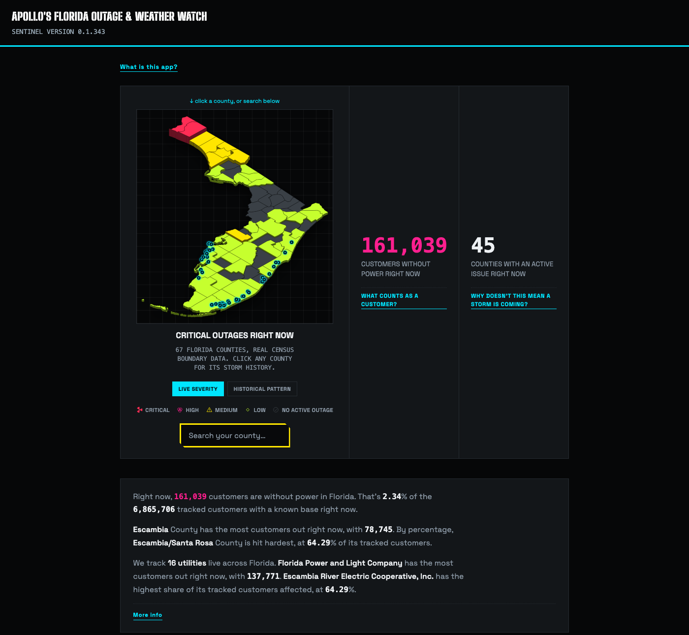

# apollo-shell

Apollo Shell — Grid Outage Tracking System (Personal Project)

**Live: [apollosentinel.app](https://apollosentinel.app)**

## Docs
- [`docs/ROADMAP.md`](docs/ROADMAP.md) — what's built, in progress, and proposed
- [`docs/documentation.md`](docs/documentation.md) — the project's narrative log
- [`docs/product-review-weather-correlation.md`](docs/product-review-weather-correlation.md) — the weather/outage correlation feature in detail
